# El pipeline paso a paso

Este documento recorre el diagrama visto en clase ([diagrama-pipeline.html](diagrama-pipeline.html)) y explica, para cada paso, **qué es**, **qué hicimos**, **por qué** y **qué resultado obtuvimos**. Al final se cubren los pasos que exige la rúbrica pero que no aparecen en el diagrama (comparación estadística, test, t-SNE y el experimento de color).

Todas las cifras salen de la notebook [`clasificador_felideos.ipynb`](../notebooks/clasificador_felideos.ipynb) y las figuras están en [`outputs/figures/`](../outputs/figures/).

```
 ┌────────┐    ┌────────────────────┐    ┌──────┐    ┌──────────────────┐    ┌──────────────────────┐
 │ DATOS  │ →  │ FEATURE EXTRACTION │ →  │ EMB  │ →  │ FEATURE SELECTION│ →  │ MODELOS              │ → especie
 │ 850    │    │ a) clásica         │    │ 2048 │    │ * solo tabular   │    │ SVM vs. Random Forest│
 │ fotos  │    │ b) transfer ✓      │    │ dims │    │   → se omite     │    │ + optimización (CV)  │
 └────────┘    └────────────────────┘    └──────┘    └──────────────────┘    └──────────────────────┘
```

---

## Paso 1 · Datos

**Qué es:** el conjunto de imágenes de entrada. En la pizarra, el cilindro; los tipos de dato posibles son texto, series de tiempo, tabulares o imágenes. Nuestro caso es **imágenes**.

**Qué hicimos:**
- Usamos la exportación **v2** del dataset *classificador_felideos* (Roboflow Universe, CC BY 4.0): **850 fotos a color de 450×450**, ya divididas en train (680), valid (85) y test (85).
- **5 especies:** *L. geoffroyi*, *L. pardalis*, *L. tigrinus*, *L. wiedii* y *P. onca*.
- **Partición:** unimos train + valid en un **conjunto de desarrollo de 765 fotos**, sobre el que se hace toda la validación cruzada. Las **85 de test** se apartan y se usan una sola vez al final.
- Antes de modelar, hicimos el **EDA** (notebook, sección 3).

**Por qué v2:** de las 4 exportaciones disponibles, es la única **a color** que tiene **las 5 especies en todos los splits**. v3 y v4 no tienen *wiedii* ni *onca* en valid/test. La "segmentada", pese al nombre, conserva el fondo. Además, verificamos que las 4 versiones son **las mismas fotos** con distinto procesamiento, así que mezclarlas habría metido fotos de test en el entrenamiento (fuga de datos).

**Resultados del EDA:**

| Pregunta | Respuesta |
| --- | --- |
| ¿Está balanceada? | Train sí (135–137 por especie). Valid/test no tanto (11–23) → usamos **F1 macro** |
| ¿Resolución? | Todas 450×450 (Roboflow las estiró: se pierde la relación de aspecto) |
| ¿Normalizada? | Píxeles en [0, 1], media ~0.42 y std ~0.23 por canal. Se normaliza con media/std de ImageNet antes de la red |
| ¿Fuga de datos? | No: 0 imágenes duplicadas (hash MD5) |
| ¿Estacionalidad / skewness? | No aplican a imágenes |
| **Hallazgo** | **32 % de las fotos son infrarrojas** (nocturnas, sin color): ~50 % de *pardalis* y *wiedii*, solo ~16 % de *onca* |

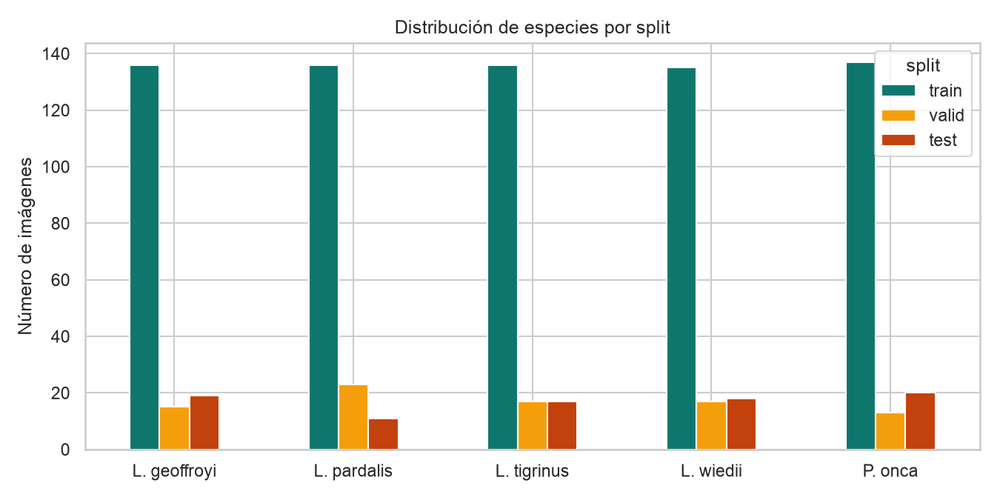
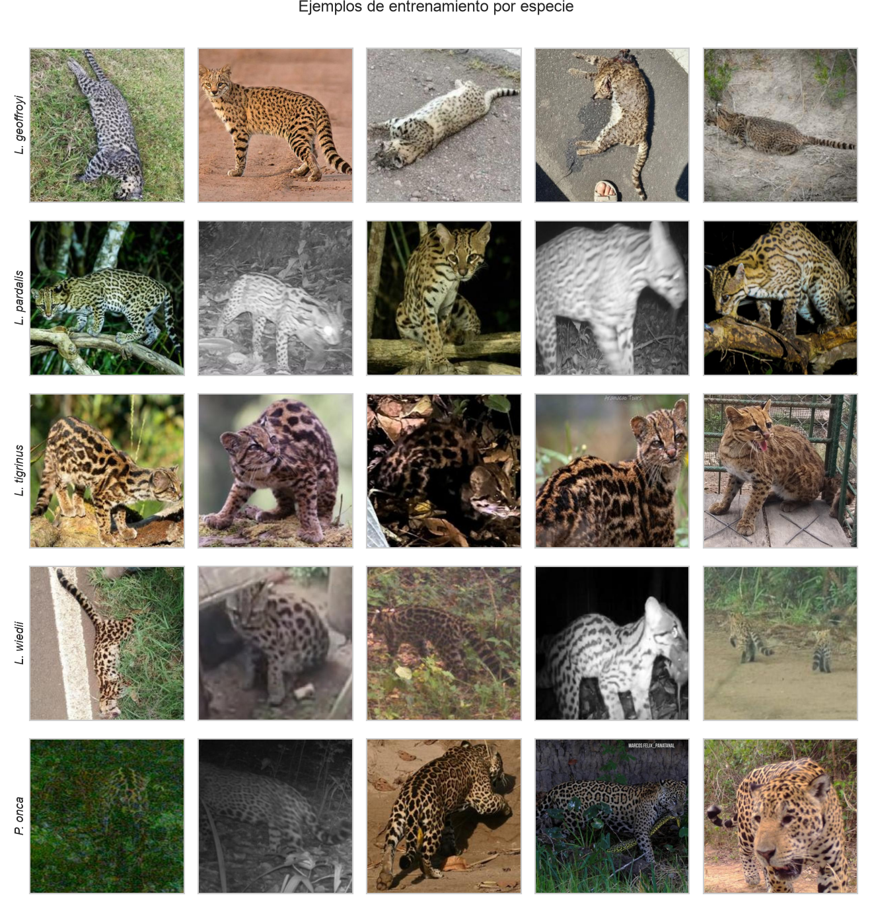
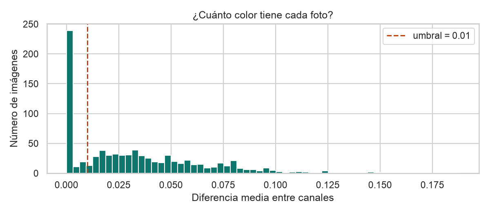

---

## Paso 2 · Feature extraction

**Qué es:** convertir cada foto en números que un modelo de ML pueda usar. La pizarra muestra dos caminos:
- **a) Clásica:** píxeles → PCA, o descriptores hechos a mano (HoG, SIFT + Bag of Visual Words).
- **b) Transfer learning:** pasar la foto por una red neuronal ya entrenada con millones de imágenes y usar su salida. En la pizarra aparece **CLIP** como ejemplo.

**Qué hicimos:** **opción b**, con **ResNet50** preentrenada en ImageNet.
- La ResNet50 es una red convolucional de 50 capas (He et al., 2015). Sus **conexiones residuales** (atajos entre capas) permiten entrenar redes muy profundas.
- Le quitamos la última capa (la que elige entre las 1000 categorías de ImageNet) y la usamos como **extractor fijo**: no se reentrena.
- Cada foto se redimensiona a 224×224, se normaliza con la media/std de ImageNet y pasa por la red.
- Se calculan los vectores **una sola vez** (8.8 s para las 850 fotos en la GPU del Mac) y se guardan.

**Por qué transfer learning y no la opción clásica:**
- Con 765 fotos, entrenar una red desde cero sobreajustaría.
- La ResNet50 ya aprendió a reconocer bordes, texturas y patrones (manchas, rayas), justo lo que distingue estos pelajes.
- El t-SNE (más abajo) lo confirma: con píxeles crudos las especies quedan totalmente mezcladas; con la ResNet50 forman grupos.

**Por qué ResNet50 y no CLIP:** ambos son transfer learning. ResNet50 es el estándar más documentado y fácil de defender. **CLIP queda como plan B** si se quiere probar otro extractor.

---

## Paso 3 · Embedding (vector)

**Qué es:** la salida del extractor, en la pizarra "emb" / "vector". Es la "huella numérica" de cada foto.

**Qué obtuvimos:**
- Un vector de **2048 números por foto** (salida del *global average pooling* de la ResNet50).
- `X_dev`: 765 × 2048 · `X_test`: 85 × 2048.

**Por qué importa:** a partir de aquí el problema deja de ser de imágenes y pasa a ser **tabular**: una tabla de 850 filas (fotos) × 2048 columnas (características) + la columna de la especie (target). Todo lo que sigue usa scikit-learn sobre esa tabla.

**Chequeo rápido** (sin optimizar, 5-fold): SVM F1 macro 0.684, Random Forest 0.694. El azar sería 0.20, así que los vectores ya contienen información útil.

---

## Paso 4 · Feature selection *

**Qué es:** quedarse solo con las características más útiles (p. ej. con un filtro univariado como `SelectKBest`). En la pizarra lleva un **asterisco** y la nota **"Tabular Data"**: solo aplica a datos tabulares.

**Qué hicimos:** **se omite**, y se justifica en la notebook (sección 5).

**Por qué:**
- La rúbrica lo permite explícitamente con transfer learning o imágenes.
- Las 2048 características son representaciones **densas y aprendidas** por la red; ninguna tiene significado propio ("la columna 734" no es "tiene manchas"). Filtrarlas una por una descartaría información que los modelos aprovechan en conjunto.

---

## Paso 5 · Modelos

**Qué es:** los algoritmos de ML que aprenden a predecir la especie a partir del vector. Debajo del óvalo, la pizarra dibuja dos cosas: la **curva de optimización de hiperparámetros** y las **barras "→ Target"**, que representan la validación cruzada.

### 5.1 Pipeline

Cada modelo va dentro de un `Pipeline` de scikit-learn:

```
StandardScaler → clasificador
```

**Por qué:** el escalador se ajusta **dentro de cada fold**, solo con los datos de entrenamiento de ese fold, así que no se filtra información del fold de validación. El mismo pipeline se usa en la optimización, la comparación y el test final.

### 5.2 Los dos modelos

| | SVM (kernel RBF) | Random Forest |
| --- | --- | --- |
| Idea | Frontera de **máximo margen** entre clases, en un espacio transformado por el kernel | **Ensamble de árboles** de decisión; vota la mayoría |
| Hiperparámetros | `C` (penalización), `gamma` (alcance del kernel) | `n_estimators`, `max_depth`, `max_features` |
| Por qué | Rinde bien con muchas dimensiones (2048) y pocos ejemplos | Familia muy distinta → la comparación es informativa |

### 5.3 Validación cruzada (las barras "→ Target")

- `RepeatedStratifiedKFold`: **10 folds × 10 repeticiones = 100 evaluaciones** por configuración.
- **Estratificado:** cada fold mantiene la proporción de especies.
- **Repetido:** reduce la variabilidad de depender de una sola partición.
- **Misma semilla** en todo el proyecto, así los dos modelos se evalúan en exactamente los mismos folds.
- **Métrica: F1 macro**, para que todas las especies pesen igual.

### 5.4 Optimización de hiperparámetros (la curva de la pizarra)

`GridSearchCV` sobre el CV 10×10. Ante empates se eligió el modelo **más simple** (menor `C`, árboles menos profundos).

| Modelo | Mejores hiperparámetros | F1 macro | Tiempo |
| --- | --- | --- | --- |
| **SVM** | `C = 100`, `gamma = 1e-4` | **0.776 ± 0.040** | 7.8 min |
| SVM con Optuna (extra) | `C ≈ 21.6`, `gamma ≈ 1.4e-4` | 0.780 | 9.7 min |
| Random Forest | 500 árboles, `max_depth = 20`, `max_features = 0.1` | 0.710 ± 0.047 | 36.5 min |

- **SVM:** `gamma` es decisivo. Con valores grandes el modelo colapsa y predice casi una sola especie (F1 ≈ 0.07). Con `gamma ≈ 1e-4` y `C ≥ 10` se llega a una meseta. Optimizar subió el F1 de 0.68 a 0.78.
- **Random Forest:** la profundidad casi no importa a partir de 20; `max_features = 0.1` es lo mejor.
- **Optuna** encontró prácticamente lo mismo que la grilla (+0.004): la grilla ya había dado con la región óptima.

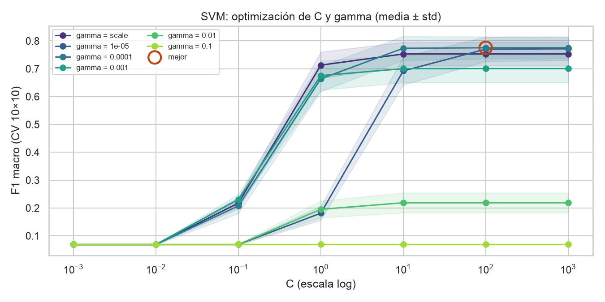
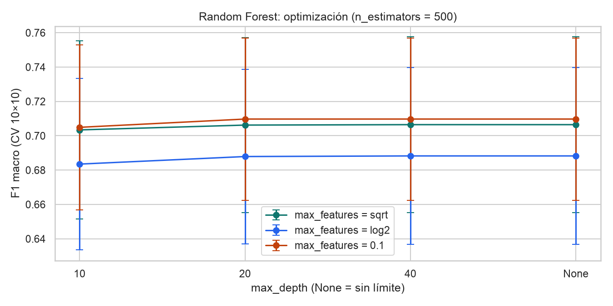

### 5.5 Curvas de aprendizaje

Ambos modelos sacan **F1 = 1.0 en entrenamiento**, y el F1 de validación **sigue subiendo** al agregar imágenes (SVM: de 0.50 con 70 fotos a 0.78 con 690). Es un caso de **varianza alta**: con más fotos el modelo mejoraría. El SVM está por encima del RF en todos los tamaños.

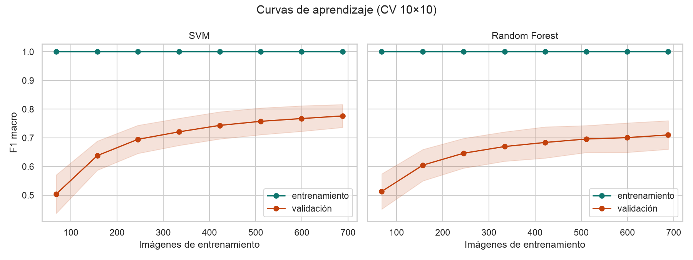

---

## Después del diagrama: lo que pide la rúbrica

### 6 · Comparación estadística: SVM vs. Random Forest

**Qué hicimos:** ambos modelos optimizados, evaluados en los **mismos 100 folds**, con todas las métricas que pide la rúbrica.

| Métrica (CV 10×10) | SVM | Random Forest |
| --- | --- | --- |
| Accuracy | **0.775** | 0.712 |
| Precision macro | **0.787** | 0.719 |
| Recall macro | **0.776** | 0.713 |
| F1 macro | **0.775** | 0.710 |
| F1 weighted | **0.774** | 0.708 |
| AUC ROC macro | **0.949** | 0.928 |
| AUC ROC micro | **0.956** | 0.934 |

**Test de hipótesis** (H₀: no hay diferencia en F1 macro; α = 0.05):

| Test | Resultado | Conclusión |
| --- | --- | --- |
| Shapiro–Wilk sobre las diferencias | p = 0.20 | No se rechaza la normalidad |
| **Wilcoxon pareado** | W = 58, **p = 2.2 × 10⁻¹⁷** | **Se rechaza H₀** |
| t-test corregido (Nadeau–Bengio) | p = 3.4 × 10⁻⁵ | Se rechaza H₀ |

- **El SVM es mejor:** +0.066 de F1 macro y gana en **93 de 100 folds**.
- **Por qué Wilcoxon:** los scores están pareados (mismos folds) y no exige normalidad.
- **Por qué el t corregido:** los folds de un CV repetido no son independientes (comparten datos de entrenamiento), lo que hace optimistas a los tests clásicos. El t corregido lo compensa, y la conclusión se mantiene.

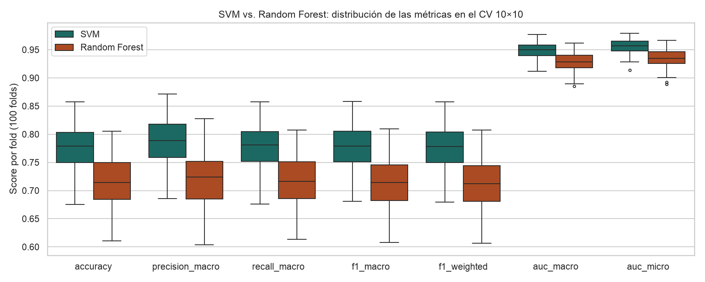
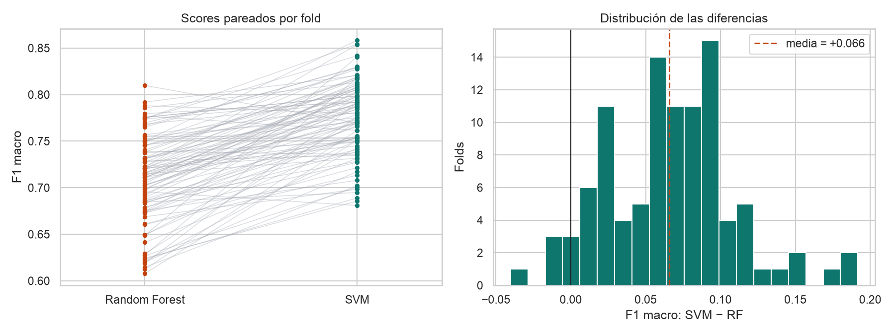
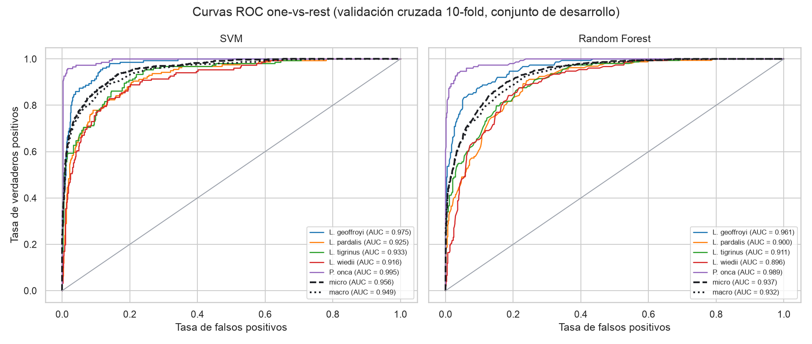

### 7 · Evaluación final en test

Ambos modelos se reentrenan con las 765 fotos de desarrollo y se evalúan **una sola vez** en las 85 de test.

| | SVM | Random Forest |
| --- | --- | --- |
| Aciertos | 65 / 85 (0.765) | 68 / 85 (0.800) |
| F1 macro | 0.749 | 0.786 |
| AUC macro | 0.940 | 0.943 |

- **En test gana el RF, pero por 3 fotos.** Los modelos solo discrepan en 11 fotos (7 a favor del RF, 4 del SVM) y el **test de McNemar da p = 0.55: no es significativo**. Con 85 fotos no se pueden distinguir modelos tan cercanos; la evidencia fuerte es el CV (100 folds).
- El SVM en test (0.749) es coherente con su CV (0.775): no hubo sobreajuste al elegir hiperparámetros.
- **Por especie:** *L. geoffroyi* (F1 = 1.0) y *P. onca* (0.95) casi sin errores. Las confusiones se concentran en *wiedii* ↔ *tigrinus* ↔ *pardalis*.
- **Fotos infrarrojas:** el SVM acierta **82.7 % de las fotos a color** y solo **67.5 % de las infrarrojas**.

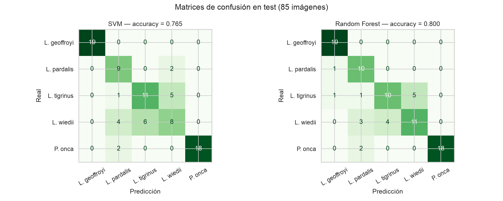

### 8 · Visualización con t-SNE

**Qué es:** una técnica que proyecta los vectores de 2048 dimensiones a 2D, intentando conservar qué fotos son vecinas. Sirve para **ver** si las especies forman grupos.

**Qué hicimos:** t-SNE de los vectores de la ResNet50 y, como contraste, de los píxeles crudos, con perplexity 15, 30 y 50.

**Resultados:**
1. **Con ResNet50 hay grupos; con píxeles crudos, todo mezclado.** Es la justificación visual del transfer learning.
2. ***P. onca* forma un grupo aparte**, coherente con su AUC de 0.995.
3. ***wiedii* y *pardalis* están dispersas y mezcladas**: son las más confundidas.
4. **Hallazgo clave:** coloreando por tipo de foto, **las infrarrojas forman su propia isla**. La ResNet50 separa primero **día/noche** y después la especie. Eso explica por qué las fotos nocturnas se equivocan más.

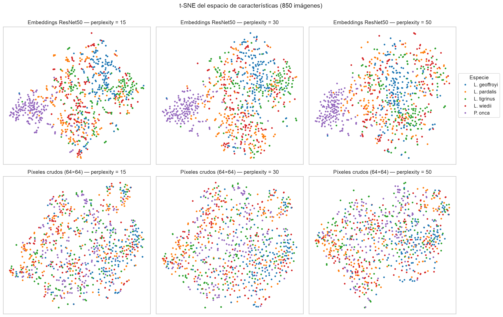
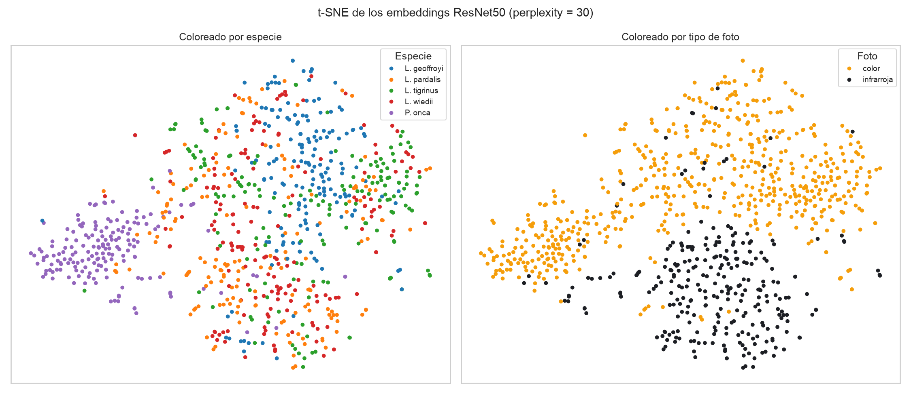

### 9 · Experimento extra: ¿importa el color?

**Qué hicimos:** el mismo pipeline (ResNet50 → SVM) con las fotos **a color** y con **las mismas fotos convertidas a gris** en código. Mismos folds, SVM reoptimizado para gris, y el F1 calculado aparte para fotos a color e infrarrojas.

| Fotos evaluadas | Color | Gris | Diferencia |
| --- | --- | --- | --- |
| Todas | 0.775 | 0.767 | +0.008 |
| Solo fotos a color | 0.794 | 0.768 | +0.026 |
| Solo fotos infrarrojas | 0.650 | 0.684 | −0.034 |

- **En total, el color casi no importa** (+0.008). El Wilcoxon lo marca significativo (p = 0.02), pero el t corregido no (p = 0.54): el efecto es mínimo y no robusto. **La información principal es el patrón de manchas.**
- **De día ayuda** (sobre todo en *wiedii* +0.09 y *tigrinus* +0.06); **de noche estorba**, porque con todo en gris las fotos nocturnas dejan de ser un grupo aparte.
- La exportación gris de Roboflow da el mismo resultado (0.763) que el gris hecho en código (0.771).

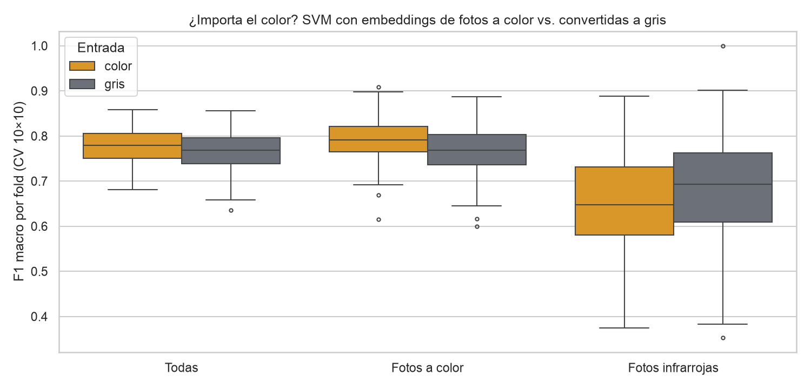

---

## Resumen en una diapositiva

| Paso | Decisión | Resultado |
| --- | --- | --- |
| 1. Datos | v2, 850 fotos a color; 765 desarrollo + 85 test | 32 % de fotos infrarrojas |
| 2. Feature extraction | Transfer learning con ResNet50 (fija) | Los píxeles crudos no separan especies; la ResNet sí |
| 3. Embedding | Vector de 2048 por foto | Problema tabular 850 × 2048 |
| 4. Feature selection | Omitida (solo aplica a tabular) | — |
| 5. Modelos | SVM vs. RF, `GridSearchCV` con CV 10×10, F1 macro | **SVM 0.776** vs. RF 0.710 |
| Comparación | Wilcoxon + t corregido | SVM mejor (p ≈ 10⁻¹⁷); gana 93/100 folds |
| Test | Una sola evaluación, 85 fotos | RF +3 fotos, no significativo (McNemar p = 0.55) |
| t-SNE | ResNet vs. píxeles; por especie y tipo de foto | La red separa día/noche antes que especie |
| Color vs. gris | Mismo pipeline, mismas fotos en gris | El color casi no importa (+0.008) |

**Conclusión:** con transfer learning y un SVM se logra un **F1 macro de ~0.78** en 5 especies con solo 765 fotos. El principal límite son las **fotos nocturnas** y las **especies de pelaje parecido**, y las curvas de aprendizaje indican que **más datos** mejorarían el modelo.
